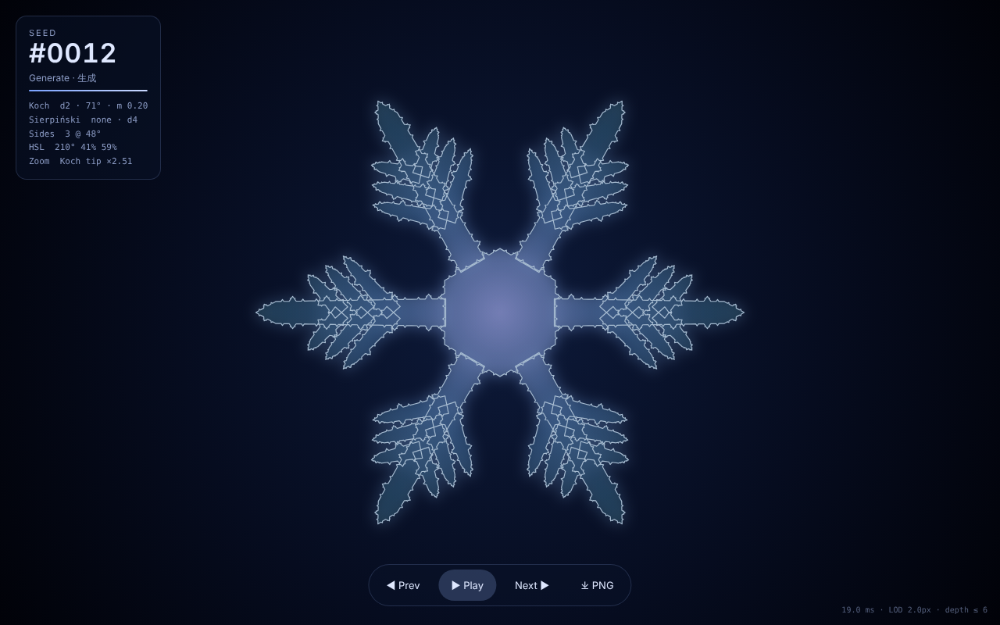
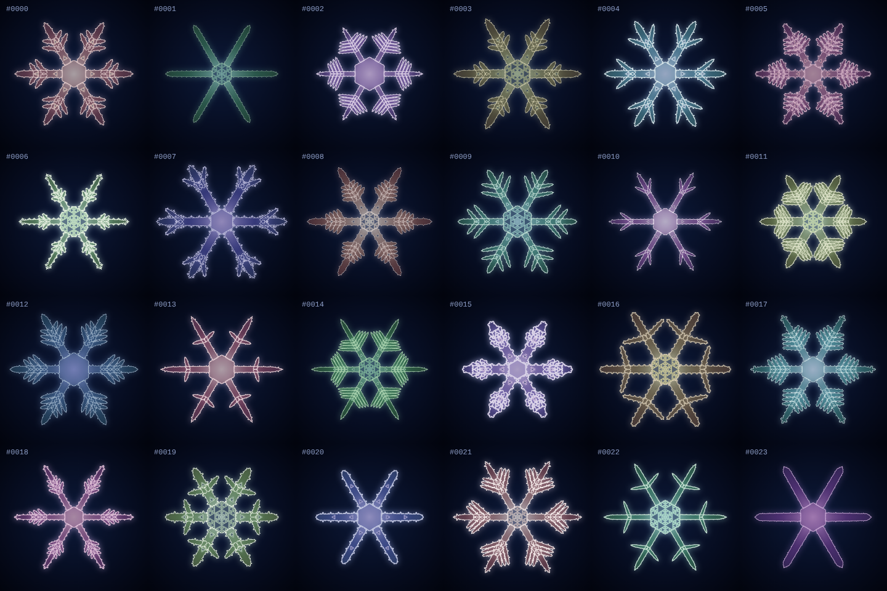
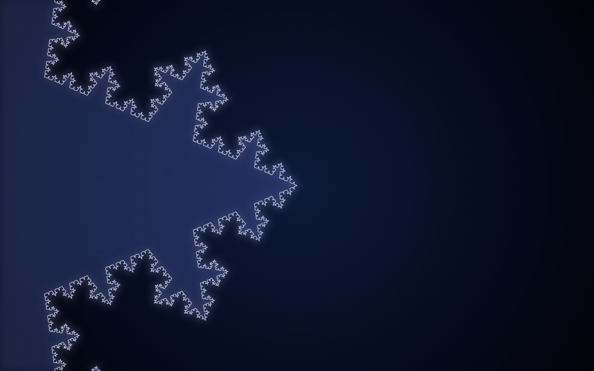
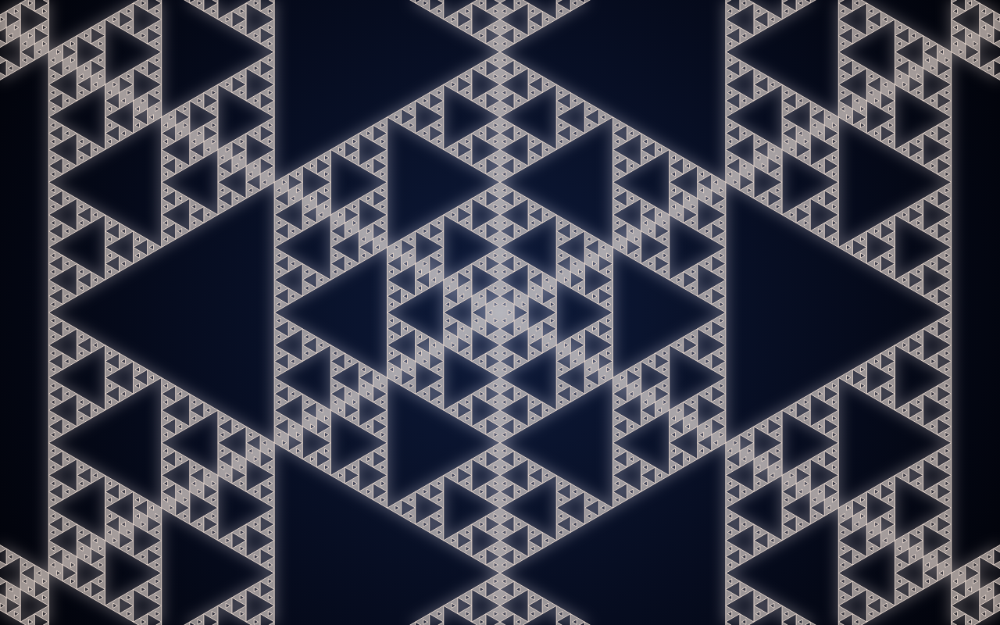

# Golden Angle Snowflakes

**黄金角シードによるフラクタル雪の結晶ジェネレーター**

整数シード `n` から雪の結晶を決定的に生成し、
「生成 → フラクタル拡大 → 縮小 → 次のシード」を無限に繰り返すアニメーション作品です。



## コンセプト

雪の結晶は **秩序** と **偶然** が同居する形です。
六回対称という厳密な規則に従いながら、二つとして同じものはありません。

この作品では両者を次のように対応させています。

| 秩序                                              | 偶然                                        |
| ------------------------------------------------- | ------------------------------------------- |
| D6 対称性、コッホ曲線・シェルピンスキーの自己相似 | シードごとに異なる形・色                    |
| 黄金比 φ に基づく低食い違い列                     | `n = 0, 1, 2, …` と進めるだけで空間を全探索 |

偶然の側にも疑似乱数は一切使いません。
「でたらめに見えるが、実は最も偏りなく空間を埋める」黄金比の列が、シード探索を担います。
`Math.random` は ESLint で禁止しています。



## シード生成プロトコル

`src/seed/seedToParams.ts` の `seedToParams(n)` は、整数から結晶パラメータへの **純関数** です。

### 1. 黄金比と黄金角

$$
\varphi = \frac{1+\sqrt5}{2}, \qquad
\mathrm{GA} = 360^\circ\left(1-\frac{1}{\varphi}\right) \approx 137.5077^\circ
$$

### 2. 色：Vogel 螺旋（2D 平面）

$$
\theta_n = n\cdot\mathrm{GA} \bmod 360^\circ, \qquad
r_n = \sqrt{\frac{n \bmod N}{N}} \quad (N = 1024)
$$

$(\theta_n, r_n)$ をそのまま **色相環** として読みます（色相 = $\theta_n$、彩度 = $35 + 55\,r_n$ %）。
ひまわりの種の配置と同じ点列なので、円盤を等面積密度で埋めます。
隣り合うシードの色相は、常に黄金角だけ離れます。

### 3. 構造：一般化黄金比 R_d 列（Roberts）

$$
g_d:\ x^{d+1} = x + 1 \ \text{の正の実根}, \qquad
\alpha_k = \frac{1}{g_d^{\,k}}, \qquad
u_k(n) = \operatorname{frac}\!\left(0.5 + n\,\alpha_k\right) \in [0, 1)
$$

$g_1 = \varphi$、$g_2 \approx 1.3247$（プラスチック数）です。
$g_d$ はニュートン法で求めています。

各 $u_k(n)$ を、次の範囲へ線形（連続値）または等幅ビン（離散値）で写像します。

| k   | パラメータ           | 範囲                              |
| --- | -------------------- | --------------------------------- |
| 1   | コッホ深さ           | 2 – 4                             |
| 2   | コッホ突起角（頂角） | 30° – 90°                         |
| 3   | コッホ突起比率 m     | 0.12 – min(0.42, 0.72·sin(θ/2)) ※ |
| 4   | コッホ粒度           | 主枝幅 × 1.0 – 2.4                |
| 5   | シェルピンスキー深さ | 2 – 5                             |
| 6   | 抜き方パターン       | none / hexagon / branch / both    |
| 7   | 主枝の長さ比         | 0.78 – 0.98                       |
| 8   | 主枝の半幅           | 0.035 – 0.07                      |
| 9   | 先端テーパー長       | 0.06 – 0.16                       |
| 10  | 中心六角形の半径     | 0.14 – 0.26                       |
| 11  | 副枝の本数           | 0 – 4                             |
| 12  | 副枝の角度           | 35° – 75°                         |
| 13  | 副枝の開始位置       | 0.22 – 0.40                       |
| 14  | 副枝の分布幅         | 0.30 – 0.50                       |
| 15  | 副枝の長さ比         | 0.18 – 0.42                       |
| 16  | 線幅                 | 0.8 – 2.2 px                      |
| 17  | 明度 (HSL の L)      | 58 – 80 %                         |
| 18  | ズーム先             | コッホ先端 / シェルピンスキー中心 |

※ 頂角 θ が小さいと突起の側辺が長くなり、曲線が自分自身に折り重なって判別不能になります。
そこで側辺長を元の線分の 0.36 倍以下に抑えています。
クランプすると上限値に偏るため、$u_3$ を「θ に応じた許容区間」へ線形に写像し、分布の一様性を保っています。

#### なぜ R_18 ではなく R_19 なのか

パラメータは 18 個ですが、$d = 18$ では $\alpha_7 \approx 0.76925$ が $10/13$ と $2\times10^{-5}$ しか違いません。
このためその軸は周期 13 で同じ値を繰り返し、まったく散らばりません。
$d \ge 18$ の中で、使う全軸が小さい分母の有理数から十分離れている最小の次元が **$d = 19$** です。
19 番目の軸は使っていません。この条件はテストで検証しています。

#### 性質

- **再現性**：同じ `n` からは常に同じ結晶ができます。
- **秩序ある全探索**：`n = 0, 1, 2, …` の先頭 N 個が、各軸を偏りなく埋めます。
  1000 シードを 10 ビンに分けたとき、全 18 軸で期待値 ±10% 以内です（テストで検証）。

## 雪の結晶の構造

- **D6 対称性**：基本セクター（0°〜30°、全体の 1/12）だけを構築し、残りは D6 の 12 元（回転 6 × 鏡映 2）で複製します。
  主枝と六角形は「軸上から始まり軸上で終わる半輪郭」として作り、鏡映で閉じます。
- **一般化コッホ曲線**：枝の輪郭の各辺を 4 本に分割します。中央の比率 m を、頂角 θ の二等辺三角形の突起に置き換えます。
  m = 1/3、θ = 60° のとき古典的なコッホ曲線です。
  曲線全体を含む包含円の半径 $R = \max\left(\tfrac12, \max_i \tfrac{d_i}{1-\ell_i}\right)$ を厳密に求め、画面外の枝を打ち切るカリングに使っています。
- **シェルピンスキー・ガスケット**：中心六角形を 6 つの正三角形ガスケットに分け、主枝内部には三角形ガスケットを置いて、`destination-out` で穴を抜きます。
- **小数深さ**：深さ 2.4 は「2 段を完全に、3 段目を 40% だけ」描くことを意味します。
  これにより生成アニメーションが連続になります。

## アニメーション

| フェーズ   | 内容                                    | 既定（秒・イージング） |
| ---------- | --------------------------------------- | ---------------------- |
| generate   | 再帰レベル 0 → 最大深さ                 | 5.0・easeInOutSine     |
| zoomIn     | 全体像 → 自己相似の不動点               | 4.5・easeInOutCubic    |
| infinite   | 無限ズーム（自己相似周期 × 3 回）       | 3.2 / 周期・linear     |
| zoomOut    | 全体像へ戻る                            | 4.0・easeInOutCubic    |
| fadeOut    | 再帰が引いていき、不透明度 0.4 まで減光 | 1.8・easeInOutQuad     |
| transition | n → n+1（**ハイブリッド**）             | 2.6・easeInOutSine     |

設定は `src/animation/config.ts` にあります。

### 継ぎ目のない無限ズーム

不動点 P の周りで自己相似比 s の図形は、「深さ d+1 をズーム s·z で見た絵」が「深さ d をズーム z で見た絵」と一致します。
そこで深さをズームに連動させます。

$$
d(z) = d_0 + \log_s z
$$

こうすると、ズームが $z_0 \cdot s$ に達した瞬間にスケールを $z_0$ へ戻し、深さを 1 下げても、画面上はまったく同じ絵になります。
ズームはこの区間を一定のコストで永遠に回り続けます。

| ズーム先                 | 自己相似比                          |
| ------------------------ | ----------------------------------- |
| コッホ（主枝の先端）     | $s = 2/(1-m)$（古典的コッホでは 3） |
| シェルピンスキー（中心） | $s = 2$                             |

継ぎ目が厳密に成り立つのは、画面が P の自己相似近傍（半径 ρ）の内側にあるときだけです。
コッホ先端の ρ は、「先端に入る最後の子線分以外の全部分」までの距離を **実際の曲線上で** 測って決めます。
ズーム量 $z_0$ は、画面の外接円がこの近傍に収まるように選びます。
テストでは、継ぎ目の前後で実際に生成した頂点集合を双方向に比較しています。

### ハイブリッド遷移

| パラメータ                                 | 遷移のしかた                                                |
| ------------------------------------------ | ----------------------------------------------------------- |
| 連続（長さ・角度・比率・線幅・色）         | 線形補間で **モーフィング**（色相は最短弧）                 |
| 離散（副枝の本数、表示中の抜き方パターン） | 違うときだけ、両方をモーフィングしながら **クロスフェード** |

遷移は再帰深さ 0 の状態で行うので、深さの違いは見た目に影響しません。
`?transition=crossfade` または `?transition=morph` で、ほかの方式にも切り替えられます。

### 60fps と自動品質調整

- 画面外は細分化しません（ビューカリング）。
- 画面上の長さが一定以下の線分も細分化しません（LOD）。
- 深さが増えても、描く頂点数は画面の大きさで頭打ちになります。

`PerformanceGovernor` は、毎フレームの CPU 時間と rAF 間隔の両方を監視します。
予算を超えると、LOD を粗く → グローを省略 → 全体像の深さ上限を下げる、の順で品質を落とします。
余裕があれば同じ順番を逆にたどって戻します。
rAF 間隔も見ているのは、Canvas2D のラスタライズが GPU 側で非同期に走るため、CPU 時間だけでは GPU 律速を検出できないからです。

## 実行方法

```bash
npm install
npm run dev        # http://localhost:5173
npm run build      # dist/ に静的ファイル
npm run preview
```

| コマンド             | 内容                                    |
| -------------------- | --------------------------------------- |
| `npm test`           | Vitest                                  |
| `npm run lint`       | ESLint + Prettier                       |
| `npm run typecheck`  | tsc                                     |
| `npm run screenshot` | `docs/*.png` を再生成（ビルド後に実行） |

### 操作

| 操作            | ボタン   | キー  |
| --------------- | -------- | ----- |
| 前のシード      | ◀ Prev   | ←     |
| 一時停止 / 再生 | ❚❚ Pause | Space |
| 次のシード      | Next ▶   | →     |
| PNG 保存        | ⤓ PNG    | S     |

### URL クエリ

| クエリ                                 | 内容                              |
| -------------------------------------- | --------------------------------- |
| `?seed=42`                             | シード指定（再生中も URL が追従） |
| `&at=11`                               | タイムラインの 11 秒目から開始    |
| `&paused=1`                            | 一時停止状態で開始                |
| `&transition=hybrid\|crossfade\|morph` | 遷移方式                          |
| `&hud=0`                               | HUD を隠す                        |

## 無限ズームのスナップショット

| コッホ先端（×2/(1−m)）           | シェルピンスキー中心（×2）                   |
| -------------------------------- | -------------------------------------------- |
|  |  |

## 構成

```
src/
  seed/        golden.ts（φ・Vogel・R_d）, params.ts（範囲定義）, seedToParams.ts
  fractal/     geometry.ts, koch.ts, sierpinski.ts, symmetry.ts（D6）,
               sector.ts（1/12 セクター）, snowflake.ts（対称化・カリング）, render.ts
  animation/   easing.ts, config.ts, timeline.ts, infiniteZoom.ts, transition.ts, perf.ts
  ui/          controls.ts（HUD）, query.ts（URL）
  main.ts
tests/         Vitest（決定性・範囲・一様性・D6 不変性・継ぎ目・遷移・ガバナー ほか）
scripts/       screenshot.cjs（Playwright）
```

## 既知の制約

- **R_d の 2 次元射影**：高次元の R_d 列は、各軸単独では極めて一様です。
  ただし一部の軸ペアは、先頭数千点の範囲では 2 次元射影に偏りが残ります（例：コッホ粒度 k=4 と線幅 k=16）。
  これは R_d 自体の性質で、d をどう選んでもいずれかのペアに現れます。
  見た目への影響は小さいため、テストは 1 次元の一様性のみを対象にしています。
- **性能の実測値**：手元の確認はヘッドレス Chromium（ソフトウェアラスタライズ）で行いました。
  GPU のある通常のブラウザでは、これより大幅に軽くなる想定です。
